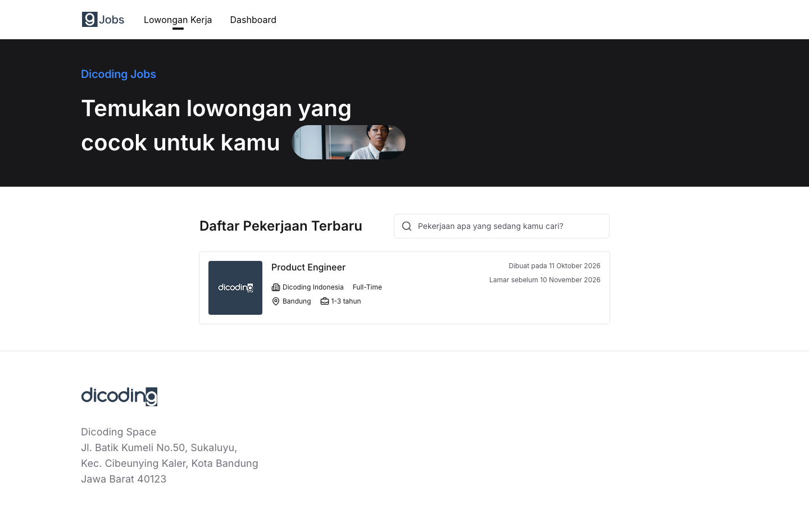
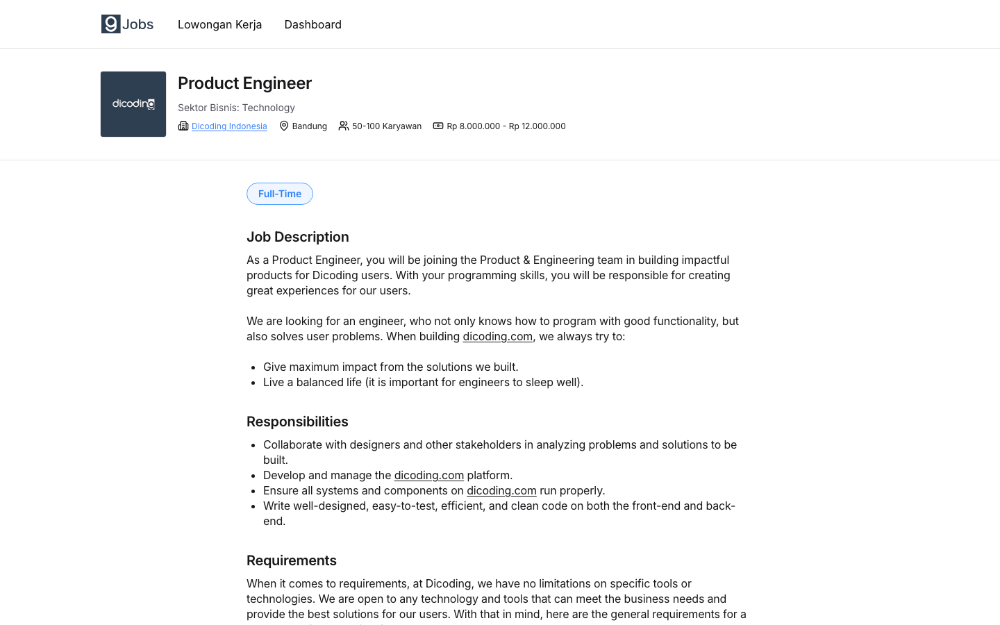
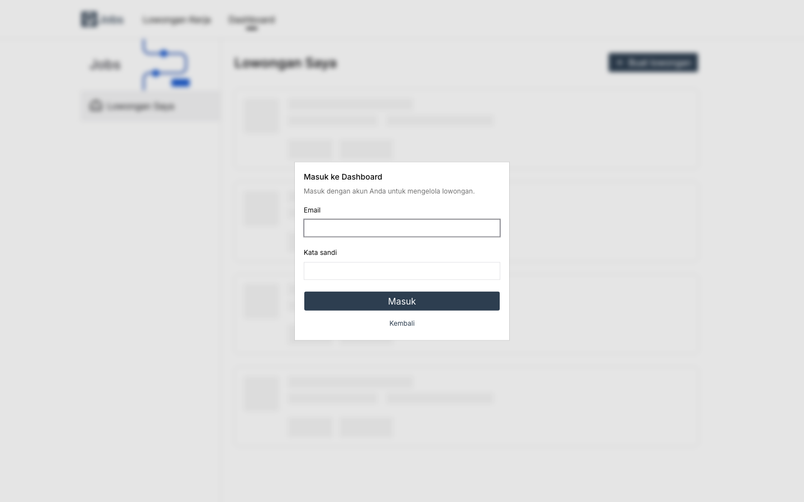
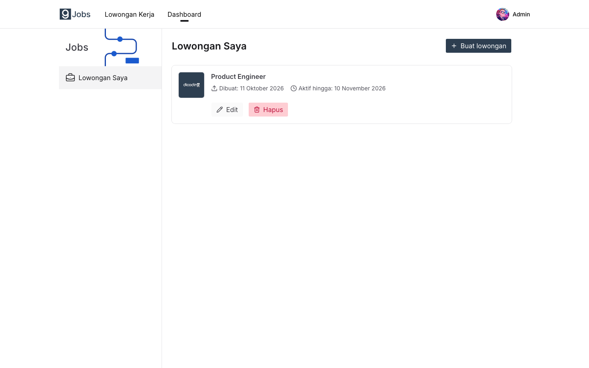
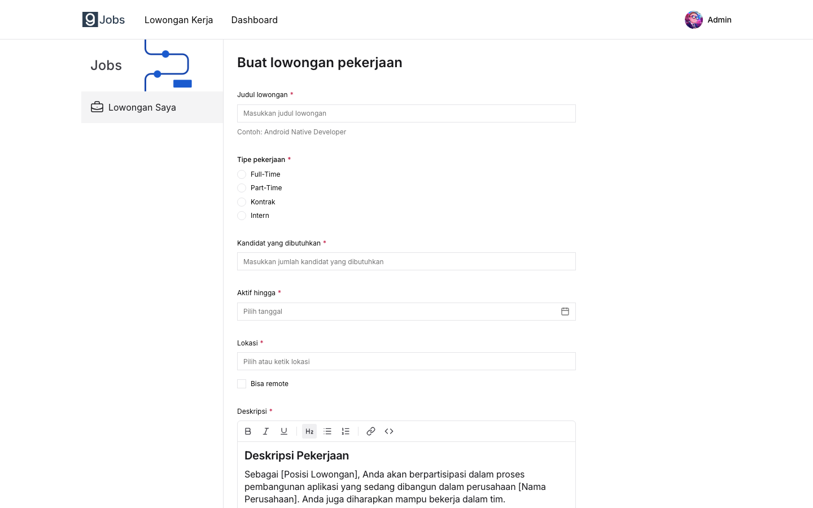

# Dicoding Jobs Platform

A job vacancy platform. Anyone can browse and search vacancies. A signed-in admin can create, edit and delete their own vacancies, and choose whether the salary range is shown publicly.

| Part                           | Stack                                          |
| ------------------------------ | ---------------------------------------------- |
| [`backend/`](backend/README.md)   | Laravel 13 JSON API, Sanctum tokens, MySQL     |
| [`frontend/`](frontend/README.md) | Next.js 16 web app, TanStack Query, Tailwind  |
| `docker/database/`             | MySQL 9 via Docker Compose, `dev` and `test` databases |
| `open-api/`                    | API request collection ([Bruno](https://www.usebruno.com/) / OpenCollection format) |

## Screenshots

**Vacancy list**



**Vacancy detail**



**Dashboard login**



**Dashboard: my vacancies**



**Create vacancy**



## Prerequisites

- Docker with Docker Compose
- PHP 8.3 or newer with `pdo_mysql`, and [Composer](https://getcomposer.org/)
- Node.js 20.9 or newer and pnpm 12 (`corepack enable`)

## Quick start

Run each step from the repository root.

1. **Start MySQL.** This creates the `dev` and `test` databases on first start, with user `app` and password `app` on port `3306`:

   ```bash
   docker compose -f docker/database/docker-compose.yaml up -d
   ```

2. **Set up and run the backend** at <http://localhost:8000/api>:

   ```bash
   cd backend
   composer setup        # install, create .env, generate key, migrate
   php artisan db:seed   # admin user and a sample vacancy
   composer dev
   ```

3. **Set up and run the frontend** at <http://localhost:3000>, in a second terminal:

   ```bash
   cd frontend
   pnpm install
   pnpm dev
   ```

4. Open <http://localhost:3000>. To reach the dashboard, sign in with:

   | Email                | Password      |
   | -------------------- | ------------- |
   | `admin@dicoding.com` | `dicoding123` |

The [backend README](backend/README.md) covers database options, the API endpoints and validation rules. The [frontend README](frontend/README.md) covers configuration, pages and project layout.

## Running all tests

Both suites need MySQL running.

**Backend** (PHPUnit, unit and integration). Uses the separate `test` database, so your `dev` data is untouched:

```bash
cd backend
composer test
```

**Frontend** (Playwright end-to-end). Needs the backend running and seeded on port 8000. Playwright starts the frontend dev server itself if it is not already running. The tests create and delete a vacancy in the `dev` database.

```bash
cd frontend
pnpm exec playwright install chromium   # first time only
pnpm test:e2e
```

See each app's README for running a single suite or test.
